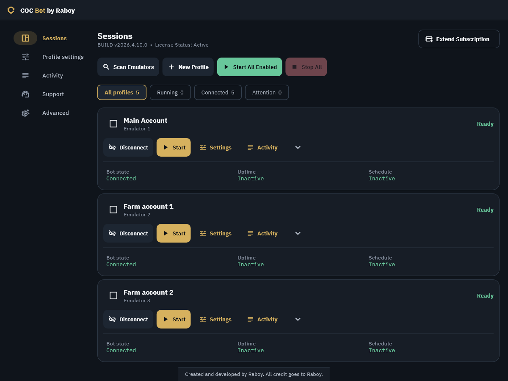

# COC Bot by Raboy: Clash of Clans bot for Windows

COC Bot is a Windows Clash of Clans bot. It farms the Main Village and Builder
Base, upgrades walls, buildings, heroes and research, donates troops, works on
Clan Games and runs several accounts at once, each in its own emulator. This
repository is its official release channel.

**[Website](https://raboys-bot.shop/)** ·
**[Download the latest release](https://github.com/Raboy-13/raboys-bot-releases/releases/latest)** ·
**[Setup guide](https://raboys-bot.shop/guides.html)** ·
**[Plans and free tier](https://raboys-bot.shop/pricing.html)** ·
**[Discord support](https://discord.com/invite/GkMefvsu8t)**

New to bots? Read [What is a COC bot?](https://raboys-bot.shop/what-is-a-coc-bot.html)

## Download and install

1. Download the Windows MSI installer from the
   [latest release](https://github.com/Raboy-13/raboys-bot-releases/releases/latest).
   The website's [Download page](https://raboys-bot.shop/download.html) shows
   the same installer with its SHA-256 checksum.
2. Run the installer and launch **COC Bot by Raboy**.
3. Follow the [setup guide](https://raboys-bot.shop/guides.html) to prepare
   your emulator, activate your license and connect your first account.

## Plans

COC Bot has a free tier and paid plans. Current prices are on the
[Pricing page](https://raboys-bot.shop/pricing.html); orders are placed in a
ticket on the official [Discord](https://discord.com/invite/GkMefvsu8t).

## ⚔️ Feature overview

**Loot more. Rest more.**

### Main Village farming

- Farm mode with configurable Gold, Elixir, and Dark Elixir goals, with
  attack rules that require any or all enabled thresholds
- Optional threshold bypass for resources whose Home Village storages are full
- Ranked mode with a configurable attack limit and optional continuation in
  Farm mode after Ranked attacks are complete
- Fast base searching and automated attacks, with configurable time-, loot-,
  and destruction-based early surrender
- Custom deployment plans for supported troops, heroes, spells, and siege
  machines
- Optional clan reinforcement requests and Clan Castle Cake support
- Chest and troop-card event assistance during normal farming
- September 2026 WWE event support in Farm battles (event ended September 30): troop reward selection,
  event troop deployment, and final Tag Tickets collection at 100% destruction
- Clean return-home and full-storage stopping behavior

### Builder Base farming

- Automatic Builder Base farming for single-stage bases and across both
  stages of two-stage battles
- Builder Star Bonus farming with optional Star Jar use
- Dedicated Builder Base deployment and early-surrender settings
- Battle Machine and Battle Copter support, including automatic hero and
  Bomber ability use
- Automatic return to Main Village when Builder Base farming finishes
- Concise in-app Builder Base farming guide

### Automatic upgrades and research

- Separate Main Village and Builder Base controls for Laboratory, Walls,
  Buildings, Heroes, upgrade priority, and resource thresholds
- Automatic wall, building, trap, and hero upgrades, plus supported Crafted
  Defense and Guardian upgrades
- Main Village Supercharge building upgrades
- Optional Town Hall and Builder Hall progression after other village
  upgrades are complete
- Bulk wall upgrades using Gold or Elixir, including Builder Base resources
- Choose Walls, Buildings, or Heroes as the preferred upgrade category;
  Walls priority reserves the final Builder for walls
- Automatic thresholds based on 95% of each eligible resource's capacity,
  or a custom resource threshold
- Main Village Laboratory research for permanent troops, spells, and siege
  machines, plus Star Laboratory research during Builder Base visits
- Automatic Builder's Apprentice and Lab Assistant assignment when available,
  including Keep Assigned confirmation
- Affordability checks, protection against Gem spending, and no automatic
  Goblin Work for Hire purchases; farming resumes when no eligible upgrade
  can be started

### Multi-account and scheduling

- Parallel farming for multiple emulator accounts
- Separate settings, labels, and saved emulator mapping for each profile
- One-click start for all enabled profiles
- Independent sessions, so one profile problem does not stop the others
- Work/rest schedules, minute or hour controls, and optional 24/7 mode
- Live work/rest countdowns, loop status, and total session uptime
- Session status filters, per-profile activity, and bulk profile actions

### Human-like operation

- Human-like behavior across navigation, battles, and session timing
- Configurable deployment order with optional variation

### Windows dashboard and updates

- Redesigned Windows workspace organized around Sessions, Profile settings,
  Activity, and Support, with direct Settings and Activity shortcuts per profile
- Per-profile Schedule, Farming, Units, and Upgrades settings, with readable
  work/rest and resource-threshold summaries
- Inline validation for settings and profile names, with pending settings
  saved before automation starts
- Responsive layouts, larger-text support, keyboard navigation, and animations
  that respect reduced-motion settings
- Real-time status and activity logs with text search, severity filters, and
  a persistent Follow Logs option
- In-app license activation, subscription extension, and license status,
  with current plans and prices loaded during activation
- Automatic update checks, verified downloads, and restart-to-update flow
- Optional update checks and downloads can run in the background while
  sessions remain accessible
- Compatibility warnings when unsupported emulator versions are running
- Support-data export for easier troubleshooting
- Self-contained MSI installer with no coding or command-line setup required

## ⚔️ Supported units

### Main Village

- **Troops:** Lavaloon, Golden Dragon, M.E.C.H.A, Giant Thrower, Barbarian
  Kicker, Broom Witch, Giant, Meteor Golem, Wall Breaker, Sneaky Goblin,
  Barbarian, Archer, Super Witch, Super Dragon, Furnace, Super Valkyrie,
  Electro Titan, Valkyrie, Dragon, Super Minion, Electro Dragon, Balloon,
  Ruin Witch, Elephant Rider, Miner, and Super Miner
- **WWE event troops:** Giant Giant, Yeti Undertaker, K.A.N.E, and YEEter
- **Heroes:** Barbarian King, Archer Queen, Grand Warden, Royal Champion,
  Minion Prince, and Dragon Duke
- **Spells:** Earthquake, Jump, Rage, Clone, Angry Spell, Totem, Lightning,
  Yellow Card Spell, and Freeze
- **Siege machines:** Wall Wrecker, Battle Blimp, Stone Slammer, Siege
  Barracks, Log Launcher, Flame Flinger, Battle Drill, Troop Launcher, and
  Sky Wagon

### Builder Base

- **Troops:** Raged Barbarian, Sneaky Archer, Boxer Giant, Beta Minion, Bomber,
  Baby Dragon, Cannon Cart, Night Witch, Drop Ship, Power P.E.K.K.A, Hog
  Glider, and Electrofire Wizard
- **Heroes:** Battle Machine and Battle Copter

Event-unit availability may change with Clash of Clans updates. WWE reward
automation ran during the September 1–30, 2026 event window (UTC).

## Supported systems

- Windows 10 or 11
- MuMu Player Android 15, LDPlayer 9, or LDPlayer 14
- Clash of Clans set to English
- Emulator resolution set to 1600 × 900 at 240 DPI
- Emulator using its standard NAT network mode

Unsupported emulator versions are not listed as available sessions. Use the
latest stable bot release for current compatibility and fixes.

## Account safety

Supercell prohibits bots and gameplay automation, and using any bot can lead
to a suspension or a permanent ban. COC Bot offers human-like interaction,
work and rest schedules and clear warnings, but they do not remove that risk.
Read [Is a COC bot safe?](https://raboys-bot.shop/account-safety.html) before
you automate an account.

---

More accounts. Smarter farming. Smarter timing. Smarter stopping. ⚔️

Independent software. Not affiliated with or endorsed by Supercell. Clash of
Clans is a trademark of Supercell Oy.
